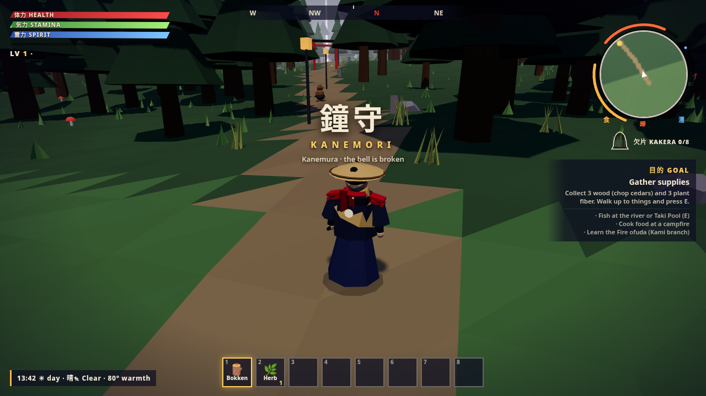
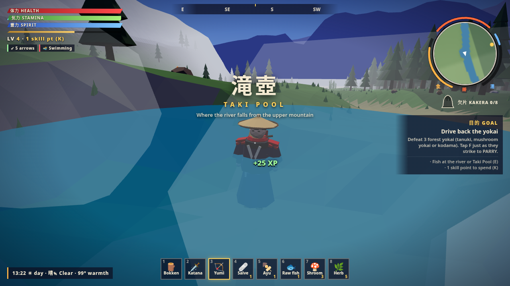

# KANEMORI 鐘守 — Keeper of the Shattered Bell

KANEMORI is a third-person open-world action-survival game on Nemuriyama, the Sleeping Mountain. Ren recovers the kakera, the shards of a shattered bell. v0.3 is the Forest and Waterfall slice with the Jorōgumo boss, now with a living village.

Play v0.3 in the browser: [https://krishristov33-cloud.github.io/Kanemori/](https://krishristov33-cloud.github.io/Kanemori/)

## What's new in v0.3

- Living village, with NPC dialogue
- Aether's rig for Ren, villagers, the horse, and the cart
- Journal
- Ranged weapons: short bow, longbow, kunai, and fire arrows
- Music for the village, forest, night, combat, and the boss
- English UI, with Japanese names optional in settings

## Controls

| Key | Action |
| --- | --- |
| Click | Look around (captures the mouse; Esc releases) |
| WASD | Move |
| Shift | Sprint |
| Space | Jump |
| Q | Dodge roll |
| LMB | Light attack (combo) |
| RMB | Heavy attack |
| F | Block · tap on hit = PARRY |
| Tab | Lock-on |
| X | Cast Fire ofuda |
| Z | Earth Wall talisman |
| E | Talk · gather · interact · fish |
| R | Swap arrow type |
| H | Mount / dismount horse |
| J | Journal |
| B | Build (campfire, lean-to) |
| I / C | Inventory & crafting |
| K | Skill tree |
| M | Scroll map |
| 1-8 | Hotbar: equip / use |
| Esc / P | Pause · save |
| F1 | Controls |
| G | Post FX on/off |

## Screenshots

