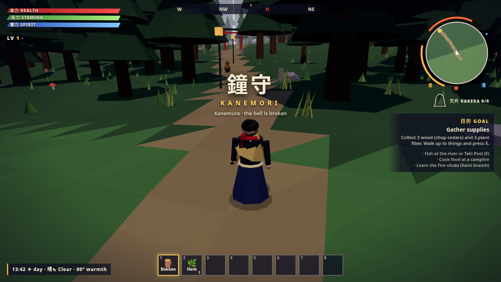
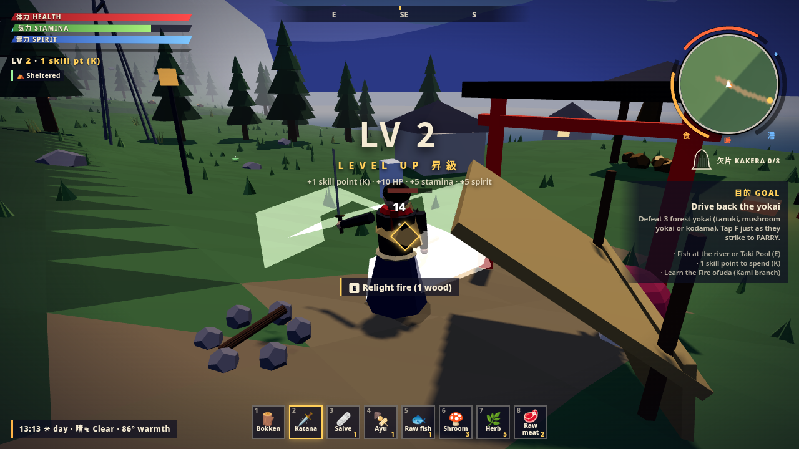
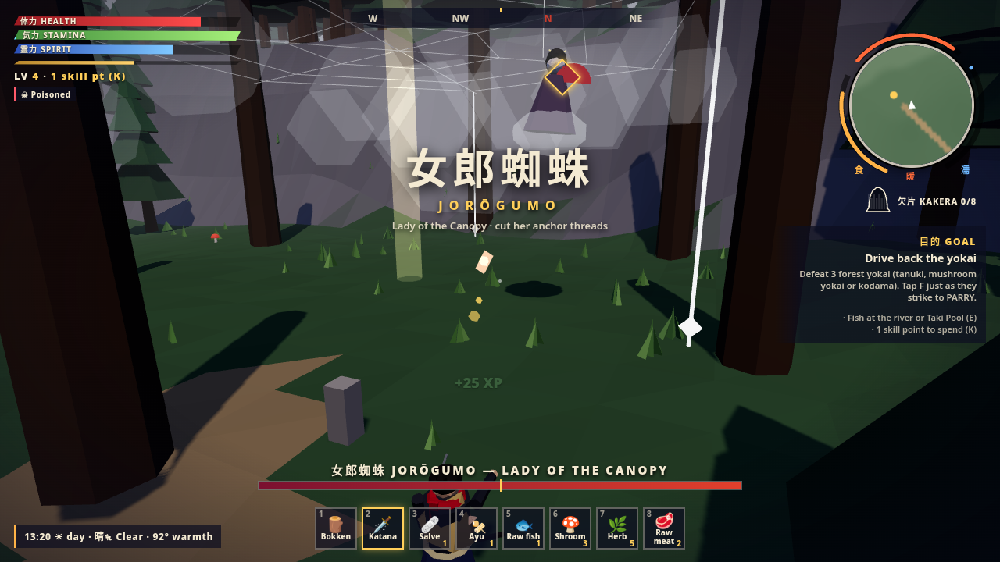

# KANEMORI 鐘守 — Keeper of the Shattered Bell

KANEMORI is a third-person open-world action-survival game on Nemuriyama, the Sleeping Mountain. Ren recovers the kakera, the shards of a shattered bell. v0.1 is the Forest and Waterfall slice with the Jorōgumo boss.

Play v0.1 in the browser: [https://krishristov33-cloud.github.io/Kanemori/](https://krishristov33-cloud.github.io/Kanemori/)

## Controls

| Key | Action |
| --- | --- |
| WASD | Move |
| Shift | Sprint |
| Space | Jump |
| Q | Dodge roll |
| LMB | Light attack (combo) |
| RMB | Heavy attack |
| F | Block · tap on hit = PARRY |
| Tab | Lock-on |
| X | Cast Fire ofuda |
| E | Gather / interact / fish at water |
| B | Build (campfire, lean-to) |
| I / C | Inventory & crafting |
| K | Skill tree |
| M | Scroll map |
| 1-8 | Hotbar: equip / use |
| Esc / P | Pause · save |
| F1 | Controls |
| G | Post FX on/off |

## Screenshots

